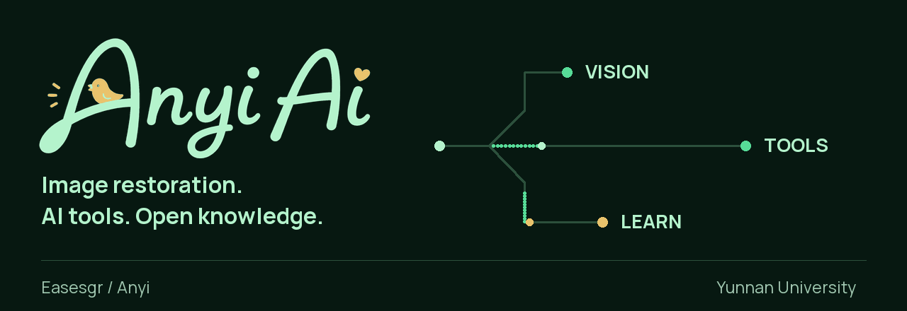
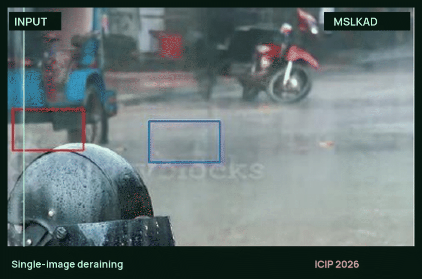
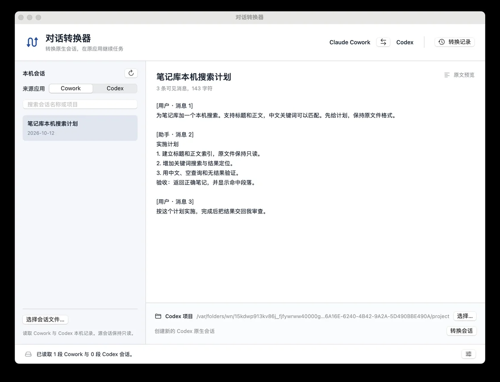

<picture>
  <source media="(prefers-reduced-motion: reduce) and (max-width: 600px)" srcset="assets/hero-mobile-static.png">
  <source media="(prefers-reduced-motion: reduce)" srcset="assets/hero-static.png">
  <source media="(max-width: 600px)" srcset="assets/hero-mobile.gif">
  
</picture>

我是 **Anyi**，在云南大学做图像复原研究，也开发 AI 工具、整理学习资料。

[研究](#研究) · [工具](#工具) · [学习站](#学习站) · [联系](#联系)

## 研究

### [MSLKAD](https://github.com/Easesgr/MSLKAD) · ICIP 2026

单图去雨的多尺度大核注意力网络。论文、PyTorch 实现、训练与推理代码、预训练模型均可在项目中找到。

<a href="https://github.com/Easesgr/MSLKAD">
  <picture>
    <source media="(prefers-reduced-motion: reduce)" srcset="assets/deraining-static.webp">
    
  </picture>
</a>

对比取自论文 Fig. 3 的 Input 与 Ours，未额外增强图像。

[论文](https://ieeexplore.ieee.org/document/11630367/) · [代码与模型](https://github.com/Easesgr/MSLKAD#quick-start) · [完整结果](https://github.com/Easesgr/MSLKAD#visual-results)

**[CDMIR](https://github.com/Easesgr/CDMIR)** — 统一多退化图像复原。研究内容为退化提示与任务感知调制；目前论文在审，代码和权重待发布。

## 工具

### [Dialogue Converter](https://github.com/Easesgr/dialogue-converter)

在 Claude Cowork 与 Codex 桌面端之间转换可见会话历史，并在原应用中接续任务。原生 macOS 工具，当前为实验预览版。

[查看源码](https://github.com/Easesgr/dialogue-converter) · [下载](https://github.com/Easesgr/dialogue-converter/releases) · [支持范围](https://github.com/Easesgr/dialogue-converter#支持范围)

## 学习站

### [安逸Ai 学习站](https://www.anyiai.cc/)

502 个内容页面、3,310 张彩色马克笔配图。按学习路线整理 AI 基础、大模型、RAG、Agent、面试题、项目实践与系统架构。

[开始学习](https://www.anyiai.cc/learning-path/) · [开源仓库](https://github.com/Easesgr/anyiai-docs) · [经典面试题](https://www.anyiai.cc/interview/)

## 常用技术

**研究**　Python · PyTorch · OpenCV 
**应用**　TypeScript · Vue · RAG · Agent 工作流 
**工程**　Git · Linux · macOS

## 联系

[学习站](https://www.anyiai.cc/) · [Email](mailto:congcong@stu.ynu.edu.cn) · [云南大学](https://www.ynu.edu.cn/)

欢迎通过项目的 Issues 交流复现问题、工具使用和内容纠错。
