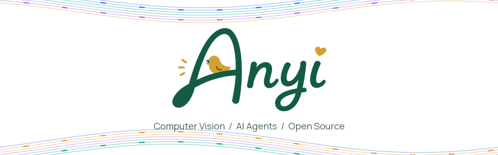
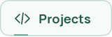
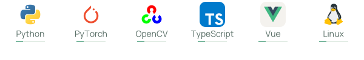
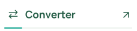

<picture>
  <source media="(prefers-reduced-motion: reduce) and (max-width: 600px)" srcset="assets/signature-mobile-static.svg">
  <source media="(prefers-reduced-motion: reduce)" srcset="assets/signature-static.svg">
  <source media="(max-width: 600px)" srcset="assets/signature-mobile.svg">
  
</picture>

<b>Hi, I'm Anyi</b> 
云南大学 · 图像复原研究 · AI Agent 开发

  <a href="https://www.anyiai.cc/" aria-label="安逸Ai 学习站"><picture><source media="(prefers-reduced-motion: reduce)" srcset="assets/action-learn-static.svg"></picture></a>
  <a href="https://github.com/Easesgr?tab=repositories" aria-label="开源项目"><picture><source media="(prefers-reduced-motion: reduce)" srcset="assets/action-projects-static.svg"></picture></a>
  <a href="mailto:congcong@stu.ynu.edu.cn" aria-label="发送邮件"><picture><source media="(prefers-reduced-motion: reduce)" srcset="assets/action-email-static.svg"></picture></a>

<picture>
  <source media="(prefers-reduced-motion: reduce) and (max-width: 600px)" srcset="assets/technologies-mobile-static.svg">
  <source media="(prefers-reduced-motion: reduce)" srcset="assets/technologies-static.svg">
  <source media="(max-width: 600px)" srcset="assets/technologies-mobile.svg">
  
</picture>

  <b>Research</b> 
  <a href="https://github.com/Easesgr/MSLKAD" aria-label="查看 MSLKAD 项目"><picture><source media="(max-width: 600px)" srcset="assets/project-mslkad-mobile.svg"></picture></a>
  <a href="https://github.com/Easesgr/CDMIR" aria-label="查看 CDMIR 项目"><picture><source media="(max-width: 600px)" srcset="assets/project-cdmir-mobile.svg"></picture></a>

  <b>Building</b> 
  <a href="https://github.com/Easesgr/dialogue-converter" aria-label="查看 Dialogue Converter 项目"><picture><source media="(max-width: 600px)" srcset="assets/project-converter-mobile.svg"></picture></a>
  <a href="https://github.com/Easesgr/anyiai-docs" aria-label="查看 AnyiAI Docs 项目"><picture><source media="(max-width: 600px)" srcset="assets/project-docs-mobile.svg"></picture></a>

